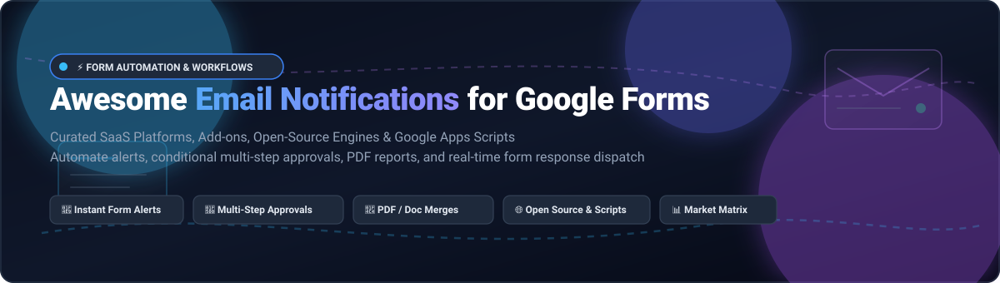

  

  
  
  
  
  

# ⚡ Awesome Email Notifications for Google Forms

> 🚀 **A curated directory of top-tier SaaS platforms, Google Workspace add-ons, open-source engines, and Google Apps Scripts for automated form response alerts, dynamic multi-step approval workflows, and personalized email dispatch.**

Whether you are looking to send immediate auto-replies to respondents, set up hierarchical team approvals, merge submissions into customized PDF documents, or bypass vendor lock-in with self-hosted open-source code, this comprehensive collection covers every proven solution across the Google Forms automation ecosystem.

---

## 📑 Table of Contents

- [📈 Sector Overview & Market Dynamics](#-sector-overview--market-dynamics)
- [💼 SaaS & Cloud Platforms](#-saas--cloud-platforms)
- [🛠️ Open-Source GitHub Projects](#️-open-source-github-projects)
- [🤝 How to Contribute](#-how-to-contribute)
- [💖 Support](#-support)
- [⭐ Star History](#-star-history)
- [⚖️ Disclaimer & Compliance](#️-disclaimer--compliance)

---

## 📈 Sector Overview & Market Dynamics

The global workflow automation and form processing market is estimated at **$23.8 billion to $27.9 billion in 2026** (with the dedicated Google Workspace development tools and add-on ecosystem reaching approximately **$4.85 billion**, projected to surpass $13.2 billion by 2035 at an 11.8% CAGR). The market structure is **moderately fragmented with a barbell concentration dynamic**: broad horizontal workflow titans like Zapier and Celonis/Make capture high enterprise valuations through universal connectivity, while a long tail of hyper-specialized Google Workspace Marketplace add-on developers (e.g., Talarian, Digital Inspiration, Jivrus) compete in a fragmented niche driven by rapid plug-and-play simplicity and domain-specific approval pipelines.

---

## 💼 SaaS & Cloud Platforms

The table below provides a competitive comparison of top SaaS platforms and Google Workspace add-ons for Google Forms email notifications and automated approvals. Entries are ranked in descending order of company size (valuation or annual revenue).

| SaaS Product | Company Size (Valuation / Revenue) | Category & Core Functionality | Pricing (Starting Paid Tier) | Free Tier Limit / Free Trial Plan |
| :--- | :--- | :--- | :--- | :--- |
| **[Make (Celonis)](https://make.com/)** | **$13 Billion valuation** (Celonis peak valuation; ~$700M+ revenue) | Visual workflow automation with Google Forms triggers & AI toolkit email formatting | **$9.00/month** (Core plan, billed annually) or $10.59/mo | **Free forever**: 1,000 credits/month, 2 active scenarios, 15-min minimum run intervals |
| **[Zapier](https://zapier.com/)** | **$5 Billion valuation** (~$310M+ ARR) | Multi-app workflow orchestration linking Google Forms to Gmail/SMTP | **$19.99/month** (Professional plan, billed annually for 750 tasks) or $29.99/mo | **Free forever**: 100 tasks/month, unlimited single-step Zaps |
| **[Form Publisher](https://form-publisher.com/)** | **$60M+ parent group revenue** (Talarian / AODocs ecosystem) | Form-to-Doc/PDF merge generator with email notifications & approvals | **$8.25/month** ($99/year billed annually; Individual Pro) | **Free forever**: 20 form submissions/month, 1 user, includes "Made with Form Publisher" badge |
| **[Sheetgo](https://www.sheetgo.com/)** | **$8M valuation** (~$1.7M ARR; $4M total funding raised) | Spreadsheet workflow automation & form submission approval routing | **$88.00/month** (Team plan, billed annually) or $125/mo | **14-day free trial** of Workflows (full features); standalone Sheets plan has free tier with 99 transfers/month |
| **[Automate.io](https://automate.io/)** | **Acquired by Notion** ($2B+ valuation at acquisition; ~$2M ARR prior) | Cloud workflow automation & forms email notification connectors | **$9.99/month** (Personal paid tier prior to Notion integration) | **Free forever**: 300 actions/month, 5 active bots, 5-minute check intervals |
| **[BoloForms Approvals](https://approval-docs.boloforms.com/)** | **~$1.5M revenue** (Bootstrapped / Early-stage SaaS) | Multi-level approval add-on with 1-click email actions & audit logs | **$8.00/month** (BoloSign/Approvals plan, billed annually) or $15/mo | **Free trial**: 14-day trial with 50 free requests; free plan includes 10 approval requests/month |
| **[Form Director](https://workspace.google.com/marketplace)** | **~$1.0M revenue** (Jivrus Technologies product suite) | Multi-service submission routing, conditional emails, and CRM integration | **$15.83/month** (Pro plan, billed annually at ~$190/year) | **14-day free trial** with full feature access; basic free tier with 20 transactions/month |
| **[Email Notifications for Google Forms](https://digitalinspiration.com/)** | **~$800K revenue** (Digital Inspiration / Amit Agarwal) | High-deliverability notification engine with dynamic Doc templates & SMS/Slack | **$49.95/year** (~$4.16/month equivalent, Standard plan) | **7-day full feature free trial**; free edition permanently capped at **20 emails/day** & 1 notification rule |
| **[Form Approvals](https://formapprovals.com/)** | **~$500K revenue** (Independent SaaS add-on) | Sequential multi-step approval workflows with AI form generation | **$12.00/month** ($36 billed per quarter; Individual plan) or $96/year | **Free forever**: 20 form responses/month, 1 admin user, unlimited approvers |
| **[Form Mule](https://www.newvisions.org/formmule)** | **Nonprofit Educational Initiative** (New Visions Cloudlab) | Google Sheets email merge add-on supporting up to 15 conditional templates | **$0.00** (100% Free tool developed for educators and public use) | **Free forever**: No license fees; constrained by Gmail quota (**500 emails/day** on `@gmail.com`, **1,500/day** on Google Workspace) |

---

## 🛠️ Open-Source GitHub Projects

Explore battle-tested open-source repositories, Google Apps Script architectures, and self-hosted form and workflow automation software with native email notification pipelines. Sorted in descending order of GitHub community stars.

1. **[n8n](https://github.com/n8n-io/n8n)**   
   Fair-code licensed visual workflow automation platform. Offers pre-built nodes for Google Forms and Google Sheets with instant Gmail/SMTP notifications, complex conditional branching, and webhook triggers with no execution limits.

2. **[Activepieces](https://github.com/activepieces/activepieces)**   
   Open-source, no-code business automation tool alternative to Zapier. Features turnkey pieces for Google Forms and Google Sheets that listen for new responses and fire automated personalized HTML emails via Gmail, SendGrid, or AWS SES.

3. **[Formbricks](https://github.com/formbricks/formbricks)**   
   Open-source survey and experience management suite. A privacy-first alternative to Google Forms that includes out-of-the-box email notification triggers, webhooks, and team collaboration workflows.

4. **[HeyForm](https://github.com/heyform/heyform)**   
   Open-source conversational form builder. Features customizable email notifications on form submission, conditional submission logic, and direct integrations with popular messaging and email services.

5. **[OhMyForm](https://github.com/ohmyform/ohmyform)**   
   Open-source form builder alternative to Typeform and Google Forms. Includes native email alerts upon submission, webhook payloads, 11 question types, and Docker/Heroku deployment targets with PostgreSQL/SQLite.

6. **[Google Forms Apps Script Email Utilities](https://github.com/labnol/google-forms)**   
   Collection of Google Apps Script automation scripts by Amit Agarwal for Google Forms. Includes scripts to send custom respondent confirmations, generate dynamic PDF attachments from submissions, and manage email quotas.

7. **[Google Forms Email Sender](https://github.com/zinadesign/google-forms-email-sender)**   
   Lightweight Google Apps Script tool that binds to a Google Form and dispatches cleanly formatted HTML emails to predefined recipients whenever a new submission is received.

8. **[Email Automation KPIs](https://github.com/Adriano-goes/email-automation-kpis)**   
   Reference architecture combining Google Forms, Google Sheets, Make, Gmail, and Power BI. Logs delivery status, SMTP errors, and quota limits to an `Automation_Log` sheet with rich visual telemetry on success/failure metrics.

9. **[Automatic Formatted Mail Sending by Google Apps Script](https://github.com/saidulislam00/Automatic-Formatted-Mail-Sending-by-Google-Apps-Script)**   
   Turnkey Google Apps Script automating email notifications with dynamic Google Docs merge templates, spreadsheet status logging, and zero third-party subscription requirements.

---

## 🤝 How to Contribute

Contributions, feature suggestions, and new open-source discoveries are warmly welcomed! 🌟

1. 🍴 **Fork** this repository.
2. 🌿 Create a descriptive feature branch: `git checkout -b feature/add-new-tool`.
3. 📝 Add your tool with verified pricing, free tier parameters, and GitHub star badges following the existing table or list format.
4. 💾 Commit your changes: `git commit -m "feat: add NewFormTool to SaaS/OSS list"`.
5. 🚀 Push to the branch: `git push origin feature/add-new-tool`.
6. 📬 Submit a **Pull Request** detailing why the tool should be included.

---

## 💖 Support

If you find this curated collection helpful for your projects, workflows, or organization:

- ⭐ **Star this repository** to show your appreciation and help other developers discover it!
- 🍴 **Fork it** to maintain your personal copy or contribute improvements.
- 📢 **Share it** with your team, network, and developer communities.
- ☕ **Sponsor the Maintainer**: Support ongoing open-source curation and development via the [GitHub Sponsor Dashboard](https://github.com/sponsors/ishandutta2007).

---

## ⭐ Star History

---

## ⚖️ Disclaimer & Compliance

- This repository is a community-curated, informational resource and does not constitute an official endorsement of any vendor or project.
- Automated email systems interacting with Google Workspace must adhere to Google's [Workspace Acceptable Use Policy](https://workspace.google.com/terms/use_policy.html), CAN-SPAM regulations, and regional data protection mandates (GDPR, CCPA).
- When leveraging Google Apps Script triggers (`MailApp.sendEmail` / `GmailApp.sendEmail`), email volumes remain subject to Google's daily recipient quotas (500/day for consumer Gmail accounts, 1,500–2,000/day for enterprise Workspace accounts).
